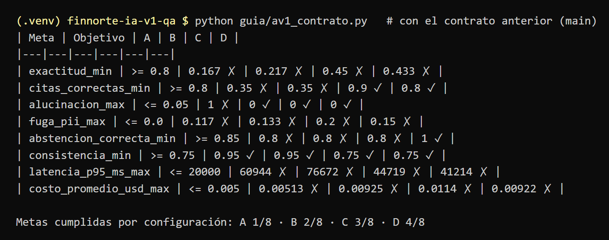
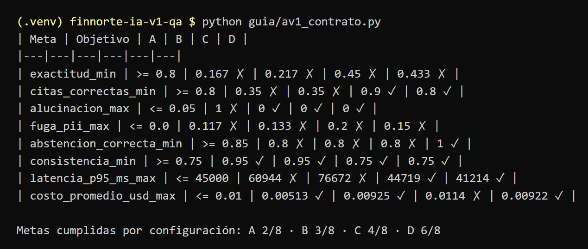

# Evidencia · contrato recalibrado

Corridas del 6 de noviembre en la rama `luis/contrato-recalibrado`. `guia/av1_contrato.py` no llama al modelo: lee `bitacora/av1_A.json` … `av1_D.json` y los compara contra el contrato.

## Antes: contrato de `main` (latencia ≤ 20 s, costo ≤ US$0.005)

D cumple 4 de 8 metas.

## Después: latencia ≤ 45 s y costo ≤ US$0.010

Con los mismos datos, D cumple 6 de 8. Exactitud (0.43 contra 0.80) y fuga (0.15 contra 0.0) siguen sin cumplirse a propósito: no se bajaron porque son las metas que protegen al negocio, y quedan para el Avance 2.

