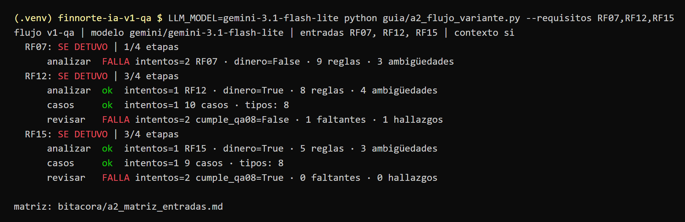

# Evidencia · matriz del flujo con 3 entradas (Lab 2, checkpoint 5)

Corrida del 6 de noviembre en la rama `luis/matriz-3-entradas`, con Gemini `gemini-3.1-flash-lite` y RAG (k=4). La consola es la salida real del script; la matriz completa está en `bitacora/a2_matriz_entradas.md`.

Ningún flujo llegó completo: las validaciones en código de `analizar` (datos personales en RF07) y de `revisar` (conteo de cobertura equivocado en RF12 y RF15) rechazaron la salida aun con el reintento. La lectura completa está en `bitacora/luis/lectura_matriz_entradas.md`.
