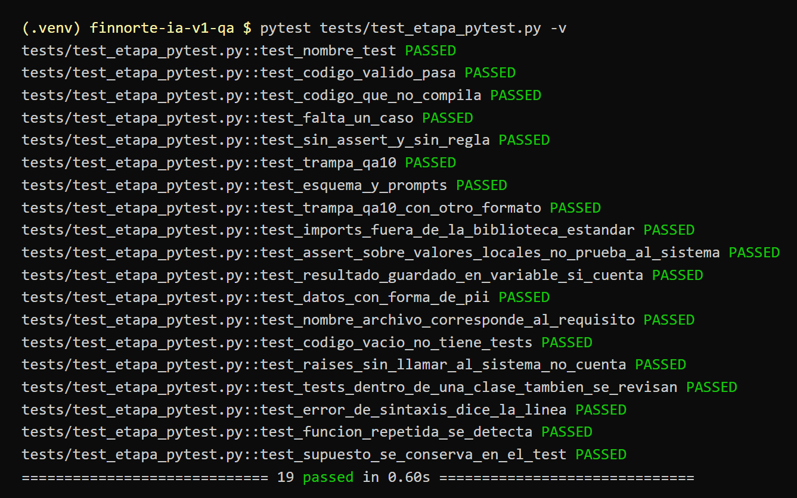
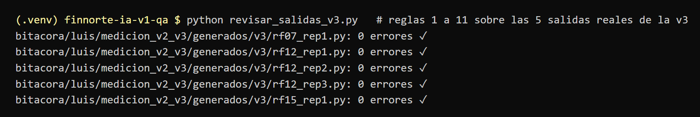

# Evidencia · reglas 10 y 11 de la etapa 4 (`qa_pytest`)

Corridas del 6 de noviembre en la rama `luis/pruebas-etapa4`, sin red (`LLM_PROVIDER=fake`, `EMB_PROVIDER=hash`).

## Pruebas de la validación

`pytest tests/test_etapa_pytest.py -v`: 19 passed. Las 6 últimas son nuevas: casos borde, test repetido (regla 10) y SUPUESTO (regla 11).

## Las reglas nuevas no rompen las salidas reales

Las 5 salidas que generó la v3 con Gemini (`bitacora/luis/medicion_v2_v3/generados/v3/`) se revisaron otra vez con las 11 reglas y ninguna tiene errores. Las reglas 10 y 11 solo agregan revisiones; no rechazan lo que ya estaba bien.

